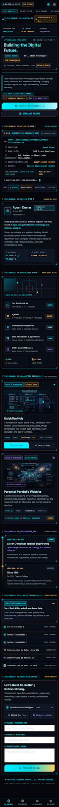

# Ayush Kumar — Digital Universe Portfolio 🚀

A futuristic, interactive developer portfolio website engineered with a sci-fi cyberpunk HUD aesthetic, dynamic Three.js 3D WebGL core, canvas particle constellations, and a Netlify serverless contact telemetry backend.



## 🌌 System Architecture & Features

- **3D Three.js Energy Core**: Real-time rotating geodesic wireframe icosahedron, concentric polyhedral core, electron rings, and particle cloud with mouse parallax.
- **Dynamic Starfield Canvas**: GPU-accelerated background particle constellations with drift dynamics and `prefers-reduced-motion` compliance.
- **Avionics Diagnostic Terminal**: Interactive retro-cyber telemetry terminal with typing animations and interactive executable commands (`status`, `run-diagnostics`, `featured-project`, `clear`).
- **Tactical Radar Constellation**: Interactive radar scope visualizer mapping verified skills and computer science foundations.
- **Classified Project Capsules**:
  - **QuickToolHub**: Interactive 9-tool suite explorer with direct links to the live production demo on Netlify and GitHub repository.
  - **Portfolio System Core**: Technical showcase of this application.
- **Chronometer Flight Timeline**: Academic timeline spanning B.Tech CSE at Gyan Ganga Institute of Technology & Science (GGITS) and Higher Secondary at Dr. C.P. Thakur College.
- **Verified Credentials Ledger**: Modern holographic badge system highlighting Oracle Cloud Infrastructure AI Foundations Associate, C++ Essentials 1, Python Essentials 1 & 2, Intro to Cybersecurity, Modern AI, and Data Science.
- **Serverless Contact System**:
  - Real Netlify serverless function (`/.netlify/functions/contact`)
  - Server-side validation and length enforcement
  - Client-side validation with real-time feedback
  - In-memory rate limiting (max 5 requests/minute per IP)
  - Anti-spam honeypot filtering
  - Honest email delivery status reporting with instant mailto fallback
- **Verified Resume Integration**: Direct download for the verified `public/assets/Ayush_Kumar_Resume.pdf`.

---

## 🛠️ Tech Stack

- **Frontend Core**: React 19, Vite 8, Tailwind CSS 3.4
- **3D & Graphics**: Three.js (WebGL), HTML5 2D Canvas API
- **Icons & Typography**: Space Grotesk, Inter, JetBrains Mono, Lucide Icons, Custom Cyber SVGs
- **Backend & Cloud**: Netlify Serverless Functions (ESM), Node.js

---

## 🚀 Getting Started Locally

### Prerequisites
- Node.js (v18+ recommended, tested on Node v24)
- npm or pnpm

### Installation

```bash
# Navigate to the project directory
cd ayush-portfolio

# Install dependencies
npm install
```

### Running Locally

```bash
# Start the Vite development server (with built-in Netlify Functions emulator)
npm run dev
```

Visit `http://localhost:5173` in your browser. Both the frontend and the `/.netlify/functions/contact` backend endpoint run seamlessly out of the box.

### Building for Production

```bash
npm run build
```

The compiled, minified production assets will be generated in `dist/`.

---

## 🌐 Netlify Deployment Guide

This portfolio is pre-configured for one-click deployment on Netlify using `netlify.toml`:

1. **Push your code to GitHub**:
   ```bash
   git init
   git add .
   git commit -m "feat: futuristic digital universe portfolio for Ayush Kumar"
   git remote add origin https://github.com/AyushkumarA99/<your-repo-name>.git
   git branch -M main
   git push -u origin main
   ```
2. **Import into Netlify**:
   - Go to [Netlify Dashboard](https://app.netlify.com/)
   - Click **"Add new site"** &gt; **"Import an existing project"** &gt; Select GitHub
   - Build settings are automatically detected from `netlify.toml`:
     - **Build Command**: `npm run build`
     - **Publish Directory**: `dist`
     - **Functions Directory**: `netlify/functions`
3. **Configure Environment Variables (Optional for Email Delivery)**:
   Under **Site configuration > Environment variables**, add:
   - `CONTACT_EMAIL`: `ayushkushwaha70935@gmail.com`
   - `EMAIL_API_KEY`: *(Your API key from [Resend](https://resend.com) or compatible email provider)*

> **Note on Email Delivery**: If `EMAIL_API_KEY` is not provided, the serverless contact function will still accept and validate transmissions, securely log them to server telemetry, and provide the sender with an immediate, prefilled `mailto` fallback link so communication is never lost.

---

## 📄 Resume PDF Verification

- Verified resume file located at: [`public/assets/Ayush_Kumar_Resume.pdf`](./public/assets/Ayush_Kumar_Resume.pdf)
- Automatically bundled into [`dist/assets/Ayush_Kumar_Resume.pdf`](./dist/assets/Ayush_Kumar_Resume.pdf) on production build.
- If you wish to update your resume in the future, simply replace this PDF file.

---

## 👨‍💻 Author Information

- **Name**: Ayush Kumar
- **Role**: Full Stack Developer | Computer Science Engineering Student
- **Institution**: Gyan Ganga Institute of Technology and Science (GGITS), Jabalpur
- **Email**: [ayushkushwaha70935@gmail.com](mailto:ayushkushwaha70935@gmail.com)
- **GitHub**: [github.com/AyushkumarA99](https://github.com/AyushkumarA99)
- **LinkedIn**: [linkedin.com/in/ayush-kumar-b7358630a](https://www.linkedin.com/in/ayush-kumar-b7358630a/)
